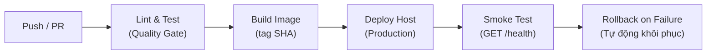

# BrewLite – Hệ thống Đặt đồ uống & Thanh toán Không tiền mặt

> **Đồ án môn học:** Công nghệ Phần mềm (Software Engineering)<br>
> **Trường Đại học Sài Gòn (SGU):** Khoa Công nghệ Thông tin<br>
> **Giảng viên hướng dẫn:** ThS. Từ Lãng Phiêu<br>
> **Học kỳ:** I – Năm học 2026–2027<br>
> **Phiên bản:** Assignment 2 (Requirements to Deployment – Ver 1.0)

[](https://github.com/tholan3006/CNPM-A2/actions/workflows/ci.yml)
[](docker-compose.yml)
[](package.json)
[](apps/web)
[](apps/api)
[](apps/api/prisma)

---

## 1. Thành viên Nhóm & Phân công Trách nhiệm

| STT | Họ và tên | MSSV | Vai trò & Phần việc phụ trách chính | Nhánh phát triển (Feature Branch) |
|:---:|:---|:---:|:---|:---|
| **1** | <span style="white-space:nowrap">**Trần&nbsp;Vĩnh&nbsp;Thọ&nbsp;Lân**</span> | `3124560049` | **Thành viên 1:** Màn hình & Luồng "Menu sản phẩm", Thiết lập Monorepo, Cấu hình CI/CD Pipeline, Traceability Matrix | `feature/tho_lan-menu-docs` |
| **2** | <span style="white-space:nowrap">**Nguyễn&nbsp;Tuấn&nbsp;Khôi**</span> | `3124410190` | **Thành viên 2:** Màn hình & Luồng "Chi tiết món, Tùy chọn Size (S/M/L) và Topping", Tính giá tự động | `tuankhoi-detail-docs` |
| **3** | <span style="white-space:nowrap">**Phan&nbsp;Vũ&nbsp;Việt&nbsp;Quang**</span> | `3124410385` | **Thành viên 3:** Màn hình & Luồng "Giỏ hàng, Khởi tạo đơn hàng & Thanh toán không tiền mặt", Idempotency Key | `feature/viet_quang-payment-docs` / `viet_quang_giohang` |
| **4** | <span style="white-space:nowrap">**Nguyễn&nbsp;Hữu&nbsp;Chí&nbsp;Công**</span> | `3124410044` | **Thành viên 4:** Luồng "Xác thực JWT, Đăng ký/Đăng nhập, Băm mật khẩu Bcrypt", Đóng gói Docker & Phục vụ API | `feature/chi_cong-auth-jwt-docs` |

---

## 2. Cấu trúc Kho Mã nguồn (Monorepo Architecture)

Hệ thống được tổ chức chuẩn theo mục 9 của đề bài `Assignment2-BrewLite.pdf`:

```text
CNPM-A2/
├── apps/
│   ├── web/                    # Frontend: Next.js 14 App Router, Mobile-first PWA, Tailwind CSS
│   │   ├── src/app/            # Các trang: Menu (/), Giỏ hàng (/cart), Checkout, Order Success
│   │   ├── src/components/     # UI Components: Modals, ProductDetail, CartDrawer, Navbar
│   │   └── Dockerfile          # Multi-stage Dockerfile cho Next.js PWA
│   └── api/                    # Backend: NestJS 10 Framework, TypeScript, Swagger OpenAPI
│       ├── prisma/             # Schema CSDL PostgreSQL, file di trú (migrations) & seed dữ liệu
│       ├── src/products/       # Module Sản phẩm: Menu, Chi tiết món, Tính giá Size/Topping
│       ├── src/orders/         # Module Đơn hàng: Vòng đời đơn, Máy trạng thái (Order State Machine)
│       ├── src/payments/       # Module Thanh toán: Cổng mô phỏng Thẻ/Ví, Cơ chế Idempotency
│       ├── src/auth/           # Module Xác thực: JWT Guard, Passport Strategy, Mã hóa Bcrypt
│       └── Dockerfile          # Multi-stage Dockerfile cho NestJS API
├── docs/                       # Toàn bộ tài liệu kỹ thuật của đồ án (Task 1 - Task 3)
│   ├── requirements/           # Task 1: Bối cảnh, 6 Stakeholders, SRS, Use-case
│   ├── diagrams/               # Task 2: 6+ Sơ đồ UML (mã nguồn .puml & vector .svg / .png)
│   ├── architecture/           # Task 3: Báo cáo kiến trúc hệ thống & 6 bản ghi ADR
│   ├── reports/                # Báo cáo cá nhân LaTeX Overleaf và Markdown của từng thành viên
│   ├── deployment.md           # Hướng dẫn chi tiết kiến trúc triển khai Production và ranh giới mạng
│   └── traceability-matrix.md  # Ma trận truy vết từ Yêu cầu (FR/NFR) -> Sơ đồ -> Code -> Test
├── tests/                      # Task 5.2: Bộ kiểm thử tích hợp & Kịch bản E2E Test (Menu -> Đơn hàng)
├── .github/workflows/          # Task 4.4 & Task 5.3: Pipeline tự động hóa
│   ├── ci.yml                  # CI: Install -> Lint -> Unit Test -> Build (Chạy khi mở PR)
│   └── cd.yml                  # CD: Tag/Push -> Quality Gate -> Build Image -> Deploy -> Smoke Test -> Rollback
├── docker-compose.yml          # Chạy trọn gói Local 1 lệnh: Web (3000) + API (4000) + Postgres (5432)
├── .env.example                # Mẫu biến môi trường an toàn, không chứa secret
└── README.md                   # Tài liệu hướng dẫn đồ án tổng thể
```

---

## 3. Hướng dẫn Khởi chạy Cục bộ (Quick Start with Docker)

Chỉ với **1 câu lệnh duy nhất**, hệ thống sẽ tự động khởi động Cơ sở dữ liệu PostgreSQL, nạp dữ liệu mẫu (seed), chạy Backend API và khởi tạo giao diện Web PWA:

### Bước 1: Sao chép file cấu hình môi trường mẫu
```powershell
Copy-Item .env.example .env
```

### Bước 2: Khởi chạy trọn gói bằng Docker Compose
```powershell
docker compose up --build -d
```

### Bước 3: Truy cập hệ thống trên trình duyệt:
* **Giao diện Ứng dụng Web PWA (Next.js):** [http://localhost:3000](http://localhost:3000)
* **Tài liệu API Swagger OpenAPI:** [http://localhost:4000/api/docs](http://localhost:4000/api/docs)
* **Endpoint Kiểm tra Sức khỏe (Health Check):** [http://localhost:4000/health](http://localhost:4000/health)

Để dừng toàn bộ dịch vụ:
```powershell
docker compose down
```

---

## 4. Chiến lược Phân chia Nhánh & Quy ước Phát triển (Git Flow)

### 4.1. Chiến lược Nhánh (Branching Strategy)
* **`main`:** Nhánh chính chứa mã nguồn ổn định, luôn sẵn sàng triển khai lên Production. Mọi commit trên `main` đều phải thông qua Pull Request (PR) được kiểm thử CI thành công.
* **`feature/<ten_thanh_vien>-<chuc_nang>-docs`:** Nhánh tính năng cá nhân của từng thành viên để phát triển độc lập, không gây ảnh hưởng đến nhau.

### 4.2. Quy ước Commit (Conventional Commits)
Nhóm áp dụng nghiêm ngặt quy ước Commit quốc tế có tiền tố:
* `feat:` Tính năng mới (ví dụ: `feat(menu): add category tabs filter`)
* `fix:` Vá lỗi hoặc sửa lỗi kiểm thử (ví dụ: `fix(ci): fix jest timeout in docker`)
* `docs:` Thêm hoặc cập nhật tài liệu (ví dụ: `docs: update traceability matrix for FR-03`)
* `chore:` Công việc bảo trì cấu hình, dependency (ví dụ: `chore: update module headers and sync CI badge`)
* `test:` Thêm ca kiểm thử Unit / Integration / E2E (ví dụ: `test: add e2e order flow test`)

### 4.3. Tiêu chuẩn Hoàn thành (Definition of Done - DoD)
Một User Story hoặc Nhiệm vụ chỉ được nghiệm thu và cho phép merge vào `main` khi thỏa mãn:
1. [x] Mã nguồn viết bằng TypeScript chuẩn, không có lỗi cú pháp hoặc cảnh báo nghiêm trọng.
2. [x] Đã viết Unit Test / Integration Test với độ bao phủ nghiệp vụ cốt lõi.
3. [x] Toàn bộ pipeline CI (`ci.yml`) vượt qua kiểm thử tự động (Lint Passed, Test Passed, Build Passed).
4. [x] Đã cập nhật tương ứng vào `docs/traceability-matrix.md` (FR/NFR ID, sơ đồ, code, test).
5. [x] Pull Request được ít nhất 1 thành viên review và phê duyệt mà không xảy ra xung đột (merge conflict).

---

## 5. Kiểm thử Hệ thống (Testing Guide)

Hệ thống được bảo vệ bởi 3 tầng kiểm thử theo chuẩn Task 5.2:

### 1. Unit Test (Kiểm thử đơn vị)
Kiểm tra tính đúng đắn của logic tính tiền, băm mật khẩu, validate dữ liệu:
```powershell
cd apps/api
npm run test
```

### 2. Integration Test (Kiểm thử tích hợp)
Kiểm tra giao dịch Transaction CSDL khi tạo đơn và thanh toán Idempotency:
```powershell
cd apps/api
npx jest src/orders/orders.integration.spec.ts
```

### 3. End-to-End (E2E) Test (Kiểm thử đầu-cuối)
Tự động chạy trọn gói kịch bản kiểm thử 7 bước từ: **Xem Menu → Chọn món → Giỏ hàng → Đặt đơn → Thanh toán → Xác nhận đơn → Health Check**:
```powershell
npm run test:e2e
```
*(Hoặc chạy trực tiếp qua `apps/api`: `cd apps/api && npm run test:e2e`)*

---

## 6. Môi trường Triển khai Thực tế (Live Production Links)

* **Ứng dụng Web PWA (Next.js):** [https://cnpm-a2.vercel.app](https://cnpm-a2.vercel.app) *(hoặc [https://brewlite-assignment2.vercel.app](https://brewlite-assignment2.vercel.app))*
* **Dịch vụ Backend API (NestJS):** [https://cnpm-a2.onrender.com](https://cnpm-a2.onrender.com)
* **Endpoint Giám sát Sức khỏe (Health Check):** [https://cnpm-a2.onrender.com/health](https://cnpm-a2.onrender.com/health)

---

## 7. Quy trình CI/CD & Cơ chế Phục hồi Sự cố (Rollback)

### 6.1. Quy trình CI/CD Pipeline



```text
Push / PR ──> Lint & Test ──> Build Image ──> Deploy Host ──> Smoke Test ──> Rollback on Failure
```

* **Tự động hóa Quality Gate:** Chặn merge vào `main` nếu bất kỳ khâu kiểm thử nào thất bại.
* **Gắn nhãn Docker Image:** Mọi image đều được gán thẻ bằng mã commit SHA rút gọn (`SHA_SHORT`) giúp dễ dàng truy vết và khôi phục.
* **Smoke Test tự động:** Sau khi deploy, pipeline tự động ping `GET /health`. Nếu phản hồi `status: "ok"`, đợt release được xác nhận thành công.

### 6.2. Cơ chế Phục hồi Sự cố (Rollback)
Nếu đợt deploy mới phát sinh lỗi nghiêm trọng:
1. **Rollback Container qua Docker Tag:**
   ```bash
   docker stop brewlite_api
   docker run -d --name brewlite_api brewlite-api:<PREVIOUS_STABLE_SHA>
   ```
2. **Rollback nhanh qua Git Release Tag:**
   ```powershell
   git checkout tags/v1.0.0
   docker compose up --build -d
   ```

---

## 8. Liên kết Tài liệu Quan trọng (Documentation Index)

* [Đặc tả Bối cảnh, 6 Stakeholders & Phạm vi (Task 1.1)](docs/requirements/context-and-scope.md)
* [Đặc tả Yêu cầu Phần mềm Toàn diện SRS (Task 1.2)](docs/requirements/srs.md)
* [Báo cáo Thiết kế Kiến trúc Hệ thống (Task 3.1)](docs/architecture/system-architecture.md)
* [Bản ghi Quyết định Kiến trúc 6 ADR (Task 3.1)](docs/architecture/adr/)
* [Hướng dẫn Kiến trúc Triển khai & Ranh giới Mạng (Task 3.2)](docs/deployment.md)
* [Ma trận Truy vết Toàn diện Yêu cầu (Traceability Matrix - Mục 8)](docs/traceability-matrix.md)
* [Thư mục Sơ đồ UML Nguồn .puml & Vector .svg (Task 2)](docs/diagrams/)
* [Kịch bản Kiểm thử E2E Đầu-cuối (Task 5.2)](tests/e2e-order-flow.spec.ts)
* [Báo cáo Sprint Review & Retrospective (Task 5.4)](docs/reports/sprint-retrospective.md)
