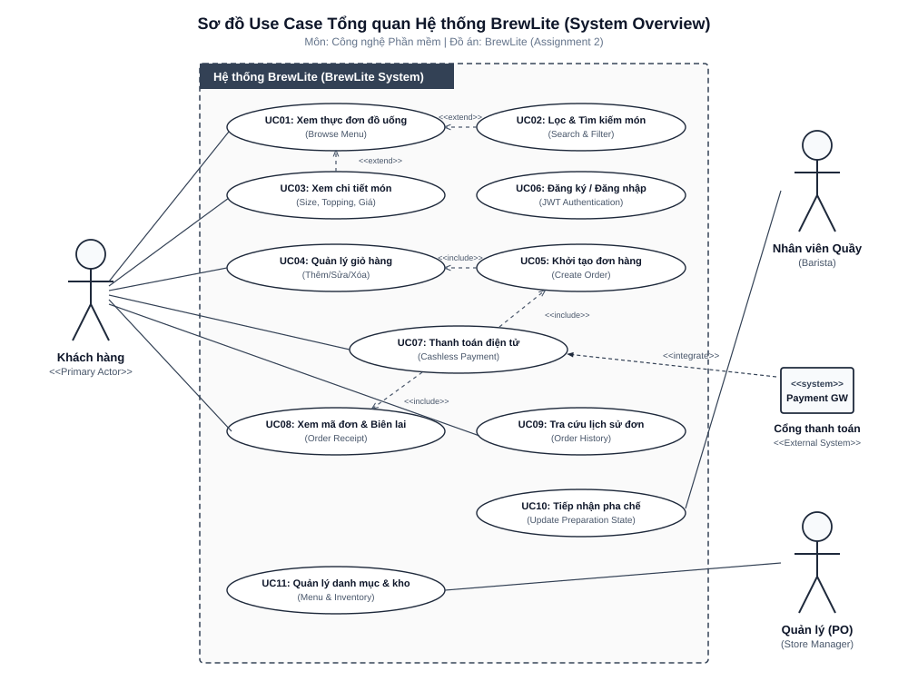

# Đặc tả Yêu cầu Phần mềm Toàn diện (System Software Requirements Specification - SRS)

**Đồ án môn học:** Công nghệ Phần mềm (Software Engineering)  
**Trường:** Đại học Sài Gòn (SGU) – Khoa Công nghệ Thông tin  
**Giảng viên hướng dẫn:** ThS. Từ Lãng Phiêu  
**Học kỳ:** I – Năm học 2026–2027  
**Đề tài:** BrewLite – Hệ thống Đặt đồ uống & Thanh toán không tiền mặt  
**Tài liệu:** `docs/requirements/srs.md` (Nhiệm vụ Task 1.2)  
**Trạng thái:** Hoàn thiện nghiệm thu Sprint 1 & Sprint 2  

---

## 1. Giới thiệu Tổng quan (System Overview)

Hệ thống **BrewLite** là ứng dụng web lũy tiến (**Progressive Web App - PWA / Mobile-First Web**) phục vụ chuỗi quy trình tự đặt món (**Self-Ordering**) và thanh toán không tiền mặt (**Cashless Payment**) tại quầy và tại bàn. Tài liệu SRS rút gọn này tổng hợp đầy đủ các yêu cầu chức năng (FR) và phi chức năng (NFR), phân loại mức ưu tiên theo mô hình **MoSCoW**, xác lập tiêu chí chấp nhận có thể kiểm chứng làm cơ sở đối soát cho các tầng kiểm thử tự động (Unit Test, Integration Test, E2E Test).

---

## 2. Sơ đồ Use-Case Tổng quát Toàn Hệ thống (System Use-Case Diagram)

Hệ thống phục vụ 2 nhóm Actor chính: **Khách hàng (Customer)** và **Nhân viên quầy (Barista)**, cùng với sự tương tác của **Cổng thanh toán mô phỏng (Mock Payment Gateway)**.

*Chi tiết mã nguồn PlantUML:* `docs/diagrams/usecase-system.puml`.

---

## 3. Bảng Yêu cầu Chức năng (Functional Requirements - FR) & MoSCoW

| Mã Yêu cầu | Tên Chức năng & Mô tả Nghiệp vụ | Mức ưu tiên (MoSCoW) | Tiêu chí Chấp nhận có thể Kiểm chứng (Acceptance Criteria) | Module Phụ trách |
|:---|:---|:---:|:---|:---|
| **FR-01** | **Xem Menu Thực đơn Đồ uống:** Khách hàng xem danh mục thực đơn đồ uống hiển thị ảnh, tên món, mô tả, giá gốc cơ sở và trạng thái còn hàng. | **Must Have** | • Trả về danh sách sản phẩm qua `GET /products` với status 200. • Màn hình Next.js render đầy đủ card món ăn, hiển thị skeleton khi đang tải (Loading state) và thông báo khi danh mục trống (Empty state). | `apps/web/src/app/page.tsx` `apps/api/src/products/` |
| **FR-02** | **Lọc Danh mục & Tìm kiếm Món:** Hỗ trợ chuyển đổi nhanh các tab danh mục (Cà phê truyền thống, Espresso, Trà hoa quả, Cold Brew, Trà & Matcha) và tìm kiếm tức thì theo từ khóa. | **Must Have** | • Bấm tab danh mục lọc đúng sản phẩm thuộc nhóm. • Ô tìm kiếm lọc real-time không phân biệt hoa thường. • Phản hồi kết quả lọc dưới 100ms trên client. | `apps/web/src/app/page.tsx` |
| **FR-03** | **Chi tiết Món, Tùy chọn Size & Topping:** Cho phép xem mô tả chi tiết, chọn kích cỡ (Size S/M/L), chọn thêm Topping và tự động tính tổng tiền món tức thời. | **Must Have** | • Endpoint `POST /products/:id/calculate-price` hoặc bộ tính toán client tính chuẩn xác: $\text{UnitPrice} = \text{BasePrice} + \Delta\text{Size} + \sum \text{Topping}$. • Đổi Size hoặc tick Topping giá tiền trên nút bấm tự nhảy real-time. | `apps/web/src/components/ProductModal.tsx` `apps/api/src/products/` |
| **FR-04** | **Quản lý Giỏ hàng & Khởi tạo Đơn:** Quản lý thêm/bớt/xóa món trong giỏ hàng, lưu trữ bền vững qua `localStorage` và tạo đơn hàng với trạng thái ban đầu `PENDING`. | **Must Have** | • Khách có thể cập nhật số lượng (+ / -) hoặc xóa món khỏi giỏ. • Bấm đặt đơn gửi request `POST /orders`, hệ thống sinh mã đơn độc nhất `#ORD-XXXXXX`, lưu CSDL PostgreSQL với trạng thái `PENDING`. | `apps/web/src/cartStore.ts` `apps/api/src/orders/` |
| **FR-05** | **Thanh toán Không tiền mặt (Ví/Thẻ):** Hỗ trợ thanh toán qua Ví điện tử hoặc Thẻ ngân hàng với cổng thanh toán mô phỏng. | **Must Have** | • Gửi request `POST /payments` kèm header `Idempotency-Key`. • Trừ tiền thành công chuyển trạng thái giao dịch sang `SUCCESS`. • Gửi lại trùng key không bị trừ tiền lần 2 (Idempotent). | `apps/api/src/payments/` |
| **FR-06** | **Xác nhận Đơn & Quản lý Trạng thái:** Hiển thị màn hình xác nhận đơn thành công, cập nhật trạng thái đơn theo vòng đời máy trạng thái. | **Must Have** | • Sau thanh toán thành công, đơn hàng tự động chuyển sang `PAID`. • Màn hình điều hướng đến `/order-success` hiển thị mã nhận đơn và thời gian ước tính. • Barista có thể chuyển trạng thái: `PAID` $\rightarrow$ `PREPARING` $\rightarrow$ `READY` $\rightarrow$ `COMPLETED`. | `apps/web/src/app/order-success/` `apps/api/src/orders/` |
| **FR-07** | **Lịch sử Đơn hàng:** Khách hàng đã đăng nhập có thể tra cứu danh sách các đơn hàng đã đặt trong quá khứ kèm trạng thái chi tiết. | **Should Have** | • Endpoint `GET /orders/my-orders` trả về danh sách đơn của đúng người dùng đang đăng nhập. • Trang `/orders` hiển thị danh sách đơn sắp xếp mới nhất lên đầu. | `apps/web/src/app/orders/` `apps/api/src/orders/` |
| **FR-08** | **Xác thực Tài khoản & Phân quyền (JWT):** Đăng ký tài khoản, đăng nhập cấp phát JWT Token Bearer, phân quyền Khách hàng (Customer) và Nhân viên quầy (Barista). | **Must Have** | • Mật khẩu được băm một chiều qua `bcrypt` (Salt = 10), không lưu plain text. • Cấp JWT Token có thời hạn hợp lệ. • Tài khoản Barista đăng nhập hiển thị thanh thông báo chế độ quản lý quầy. | `apps/api/src/auth/` `apps/web/src/components/AuthModal.tsx` |

---

## 4. Bảng Yêu cầu Phi chức năng (Non-Functional Requirements - NFR) & MoSCoW

| Mã Yêu cầu | Phân loại & Tên Yêu cầu | Mức ưu tiên (MoSCoW) | Tiêu chí Chấp nhận có thể Kiểm chứng (Acceptance Criteria) |
|:---|:---|:---:|:---|
| **NFR-01** | **Hiệu năng & Tốc độ Phản hồi (Performance):** Thời gian phản hồi API và tải trang đạt chuẩn tối ưu. | **Must Have** | • Thời gian phản hồi API lấy menu `GET /products` dưới 500ms với database PostgreSQL chuẩn. • Giao diện Next.js tối ưu chỉ số First Contentful Paint (FCP) dưới 1.5s trên mạng 4G/Wifi thông qua cấu chế PWA/Static rendering. |
| **NFR-02** | **Bảo mật & Toàn vẹn Dữ liệu (Security):** Bảo vệ thông tin tài khoản và phân quyền các route API nhạy cảm. | **Must Have** | • Mật khẩu người dùng băm bằng `bcrypt` trước khi lưu vào CSDL, tuyệt đối không xuất hiện trong response JSON. • Mọi API tạo đơn (`POST /orders`), thanh toán (`POST /payments`), xem lịch sử (`GET /orders`) bắt buộc phải có Header `Authorization: Bearer <token>`, nếu thiếu hoặc token sai trả về HTTP 401 Unauthorized. |
| **NFR-03** | **Tính Chống trùng lặp Thanh toán (Idempotency):** Ngăn chặn trừ tiền 2 lần khi khách hàng bấm liên tục do lag mạng. | **Must Have** | • Client sinh một khóa duy nhất `Idempotency-Key` (UUIDv4) gắn vào Header khi thanh toán. • Nếu server nhận request có cùng `Idempotency-Key`, server lập tức trả về kết quả của giao dịch trước đó, không khởi tạo giao dịch mới trong database. |
| **NFR-04** | **Khả năng Đóng gói & Triển khai (Deployability & Portability):** Hệ thống có thể chạy độc lập trên bất kỳ môi trường nào chỉ với 1 câu lệnh. | **Must Have** | • Cung cấp file `docker-compose.yml` chuẩn khởi chạy trọn gói Web (cổng 3000), API (cổng 4000) và PostgreSQL (cổng 5432). • Tự động đồng bộ CSDL (`prisma db push`) và nạp dữ liệu mẫu (`seed.ts`) khi khởi động. • Cung cấp endpoint kiểm tra sức khỏe `GET /health` trả về status 200 OK. |

---

## 5. Quy tắc Kiểm chứng và Ma trận Truy vết

Tất cả các yêu cầu FR và NFR trên đều được kiểm chứng thông qua bộ kiểm thử tự động gồm 3 tầng:
1. **Unit Test:** `apps/api/src/products/products.service.spec.ts` (18 ca kiểm thử kiểm tra tính giá, lọc danh mục, tìm kiếm).
2. **Integration Test:** `apps/api/src/orders/orders.integration.spec.ts` (kiểm tra giao dịch Prisma $transaction, khóa Idempotency).
3. **End-to-End (E2E) Test:** `tests/e2e-order-flow.spec.ts` (kịch bản tự động 7 bước từ Menu $\rightarrow$ Tùy chọn $\rightarrow$ Giỏ hàng $\rightarrow$ Đặt đơn $\rightarrow$ Thanh toán $\rightarrow$ Xác nhận $\rightarrow$ Health check).

Bảng ma trận truy vết chi tiết ánh xạ từ Yêu cầu $\rightarrow$ Sơ đồ UML $\rightarrow$ Mã nguồn $\rightarrow$ Ca kiểm thử được lưu trữ tại:
[docs/traceability-matrix.md](../traceability-matrix.md).
